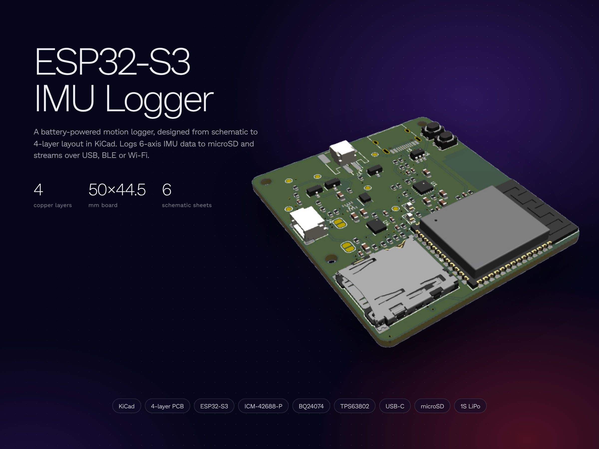
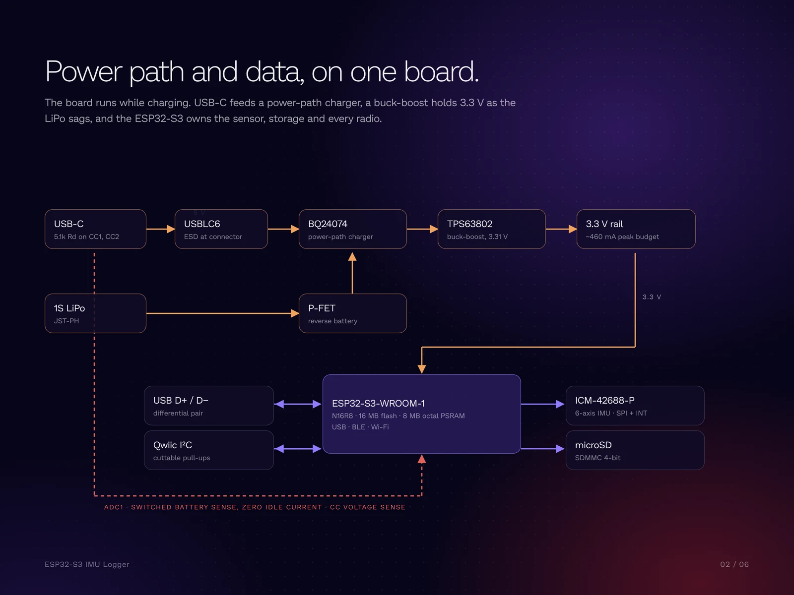
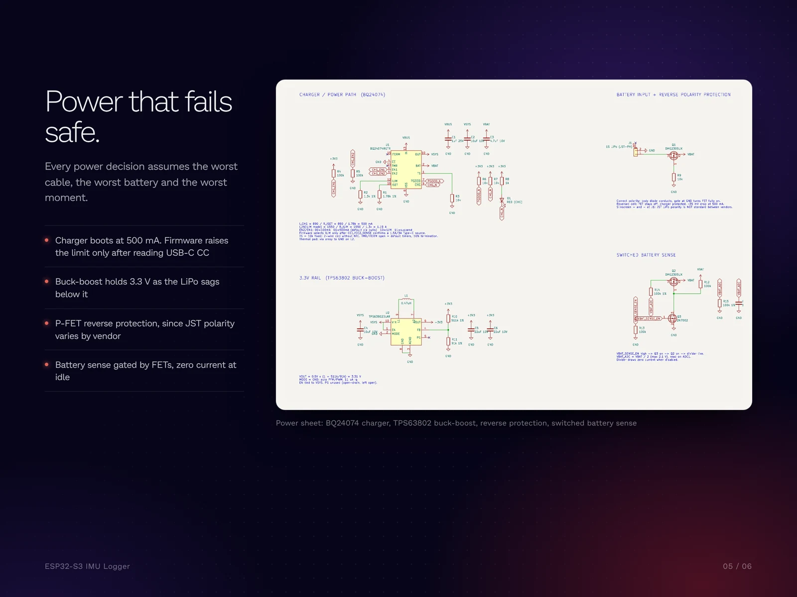
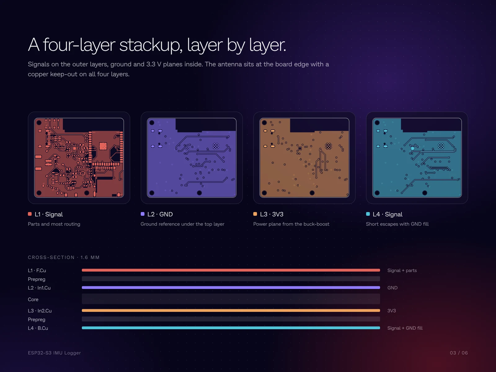
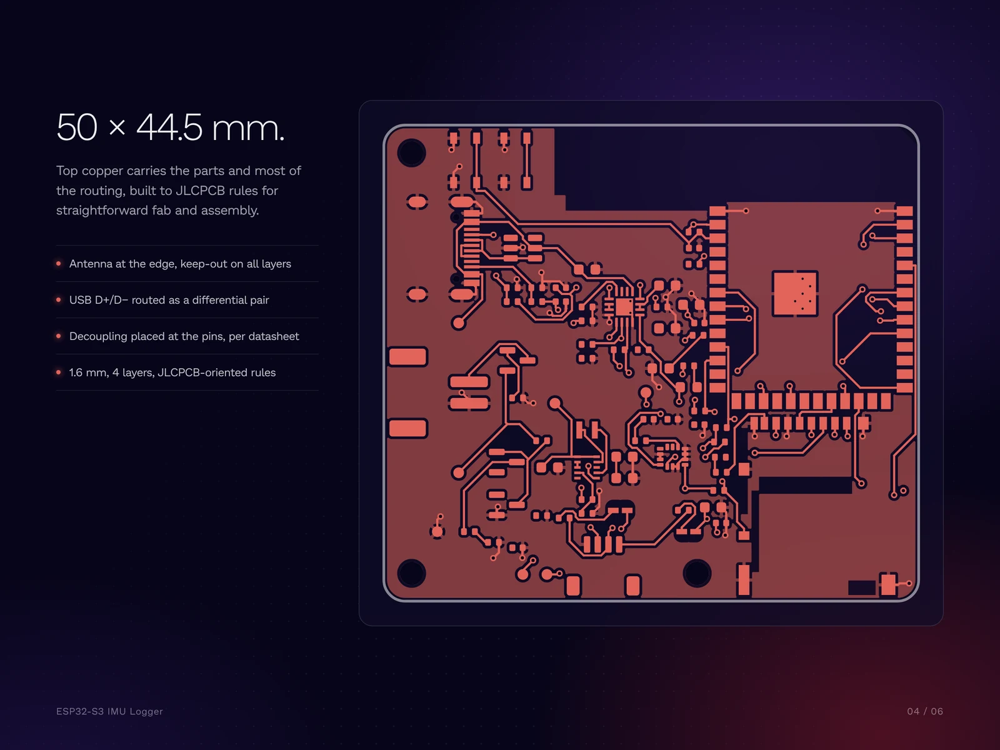
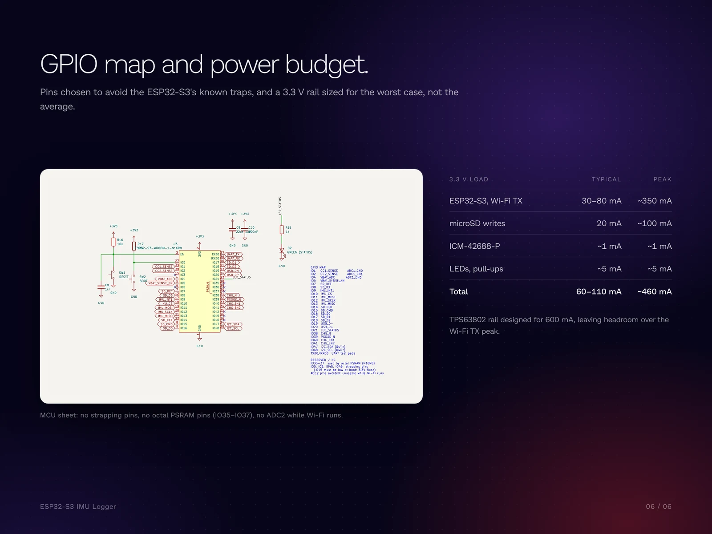

# S3 Motion Logger

ESP32-S3 motion logging board. It logs 6-axis IMU data to a microSD card and streams it over USB, BLE or Wi-Fi. It runs from a single-cell LiPo and charges over USB-C.

**Schematic:** [docs/s3-motion-logger-schematic.pdf](docs/s3-motion-logger-schematic.pdf)

## Specs

|            |                                                        |
| ---------- | ------------------------------------------------------ |
| MCU        | ESP32-S3-WROOM-1-N16R8 (16 MB flash, 8 MB octal PSRAM) |
| IMU        | ICM-42688-P, 4-wire SPI, data-ready interrupt          |
| Storage    | microSD, SDMMC 4-bit                                   |
| Power in   | USB-C, 5 V                                             |
| Battery    | 1S LiPo, JST-PH, charged at 500 mA                     |
| Charger    | BQ24074 with power path (board runs while charging)    |
| 3.3 V rail | TPS63802 buck-boost, 600 mA design budget              |
| Expansion  | Qwiic (I2C) with cuttable pull-ups                     |
| Board      | 50 x 44.5 mm, 4 layers, 1.6 mm, JLCPCB-oriented rules  |

## Block diagram

## Design decisions

- **Charger boots in a safe mode.** The BQ24074 defaults to 500 mA through the EN1/EN2 pull resistors. Firmware raises the input limit only after reading the USB-C CC voltage on the ADC and confirming a 1.5 A or 3 A source.
- **Buck-boost instead of an LDO.** The TPS63802 holds 3.3 V while the battery sags below 3.3 V. Output is set by a 511k/91k divider to 3.31 V.
- **Reverse battery protection.** A P-FET in the battery line protects the charger. JST LiPo polarity is not standardized between vendors, so this is a common failure on real boards.
- **Switched battery sense.** A divider gated by a P-FET and an N-FET draws no current when idle. It reads on ADC1.
- **USB-C done properly.** Separate 5.1k Rd on CC1 and CC2, ESD protection (USBLC6-2SC6) at the connector, and D+/D- defined as a differential pair.
- **GPIO map avoids known traps.** No use of the strapping pins, the octal PSRAM pins (IO35 to IO37), or ADC2 (unusable while Wi-Fi is running). Full map on the MCU sheet.
- **Datasheet-driven parts.** Pinouts and decoupling for the TPS63802 and ICM-42688-P were taken from the TI and TDK datasheets, with custom symbols in `motion_logger.kicad_sym`.
- **Stackup.** L1 signal and parts, L2 solid GND, L3 3V3, L4 signal and GND fill. The antenna sits at the board edge with a copper keep-out on all layers.

## Layout

## Power budget (3.3 V rail)

| Load                | Typical              | Peak             |
| ------------------- | -------------------- | ---------------- |
| ESP32-S3 (Wi-Fi TX) | 30 to 80 mA with BLE | about 350 mA     |
| microSD writes      | 20 mA                | about 100 mA     |
| ICM-42688-P         | about 1 mA           | about 1 mA       |
| LEDs, pull-ups      | about 5 mA           | about 5 mA       |
| **Total**           | **60 to 110 mA**     | **about 460 mA** |

## Open items

1. **No firmware yet.**
